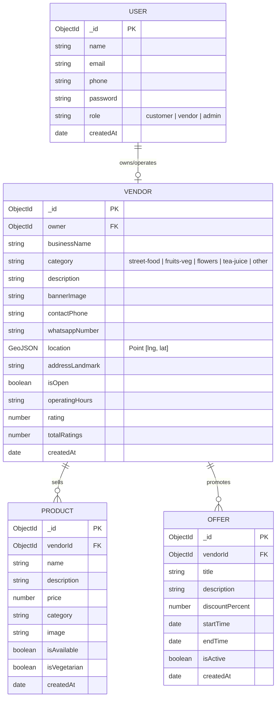

# 🗄️ StreetSpot: Database Schema & Data Models

This document details the MongoDB collections, relationships, field definitions, and indexing strategies for **StreetSpot**.

---

## 1. Entity-Relationship (ER) Overview



---

## 2. Collection Schemas in Detail

### A. User Collection (`users`)
Stores credentials and basic identity for both customers and street vendors.

```javascript
const userSchema = new mongoose.Schema({
  name: {
    type: String,
    required: [true, "Name is required"],
    trim: true
  },
  email: {
    type: String,
    required: [true, "Email or phone is required"],
    unique: true,
    lowercase: true,
    trim: true
  },
  phone: {
    type: String,
    trim: true
  },
  password: {
    type: String,
    required: [true, "Password is required"],
    minlength: 6,
    select: false // Excludes password by default in queries
  },
  role: {
    type: String,
    enum: ["customer", "vendor", "admin"],
    default: "customer"
  }
}, { timestamps: true });
```

---

### B. Vendor Stall Collection (`vendors`)
The primary entity for discovery. Stores real-time location using standard GeoJSON format for MongoDB spatial indexing.

```javascript
const vendorSchema = new mongoose.Schema({
  owner: {
    type: mongoose.Schema.Types.ObjectId,
    ref: "User",
    required: true
  },
  businessName: {
    type: String,
    required: [true, "Stall or business name is required"],
    trim: true
  },
  category: {
    type: String,
    required: true,
    enum: ["street-food", "fruits-veg", "flowers", "tea-juice", "local-goods", "other"]
  },
  description: {
    type: String,
    default: ""
  },
  bannerImage: {
    type: String,
    default: "https://images.unsplash.com/photo-1555396273-367ea4eb4db5?auto=format&fit=crop&w=600&q=80"
  },
  contactPhone: {
    type: String,
    required: true
  },
  whatsappNumber: {
    type: String,
    required: true
  },
  // GeoJSON Point format: [longitude, latitude]
  location: {
    type: {
      type: String,
      enum: ["Point"],
      default: "Point"
    },
    coordinates: {
      type: [Number], // [longitude, latitude]
      required: true,
      default: [77.5946, 12.9716] // Default fallback coordinates
    }
  },
  addressLandmark: {
    type: String,
    required: [true, "Landmark or street location is required"],
    trim: true
  },
  isOpen: {
    type: Boolean,
    default: true
  },
  operatingHours: {
    type: String,
    default: "4:00 PM - 10:00 PM"
  },
  rating: {
    type: Number,
    default: 4.5,
    min: 1,
    max: 5
  },
  totalRatings: {
    type: Number,
    default: 1
  }
}, { timestamps: true });

// CRITICAL: 2dsphere index for MongoDB geospatial discovery queries ($near, $geoWithin)
vendorSchema.index({ location: "2dsphere" });
vendorSchema.index({ category: 1, isOpen: 1 });
```

---

### C. Product / Menu Item Collection (`products`)
Stores the catalog of items sold by each stall.

```javascript
const productSchema = new mongoose.Schema({
  vendor: {
    type: mongoose.Schema.Types.ObjectId,
    ref: "Vendor",
    required: true,
    index: true
  },
  name: {
    type: String,
    required: [true, "Product name is required"],
    trim: true
  },
  description: {
    type: String,
    default: ""
  },
  price: {
    type: Number,
    required: [true, "Price in INR is required"],
    min: 0
  },
  category: {
    type: String,
    default: "General"
  },
  image: {
    type: String,
    default: ""
  },
  isAvailable: {
    type: Boolean,
    default: true
  },
  isVegetarian: {
    type: Boolean,
    default: true
  }
}, { timestamps: true });
```

---

### D. Flash Offer Collection (`offers`)
Stores time-sensitive promotions and clearance deals.

```javascript
const offerSchema = new mongoose.Schema({
  vendor: {
    type: mongoose.Schema.Types.ObjectId,
    ref: "Vendor",
    required: true,
    index: true
  },
  title: {
    type: String,
    required: [true, "Offer title is required (e.g. 10% off between 4-6 PM)"],
    trim: true
  },
  description: {
    type: String,
    default: ""
  },
  discountPercentage: {
    type: Number,
    min: 1,
    max: 100
  },
  startTime: {
    type: Date,
    default: Date.now
  },
  endTime: {
    type: Date,
    required: [true, "Offer end time is required"]
  },
  isActive: {
    type: Boolean,
    default: true
  }
}, { timestamps: true });
```

